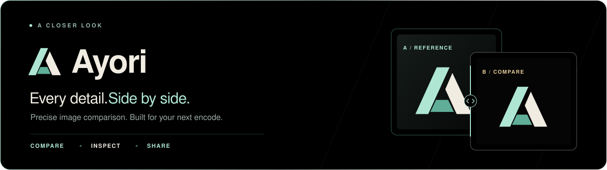
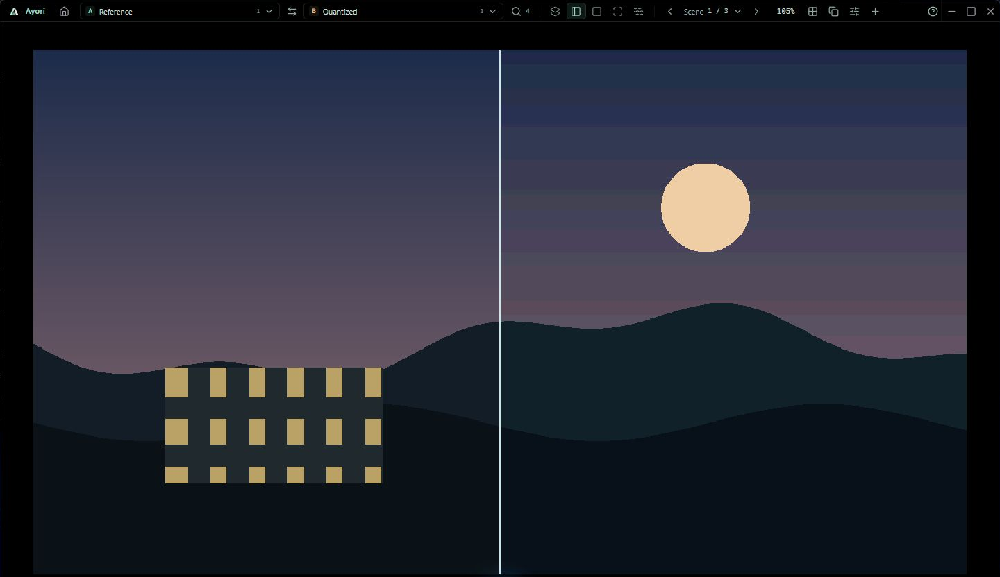

<p align="center">
  <picture>
    <source media="(max-width: 600px)" srcset="docs/images/readme-banner-compact.svg">
    
  </picture>
</p>

<p align="center">
  <a href="https://github.com/Yuui03E/Ayori-Compare/releases/latest/download/Ayori.exe"></a>
</p>

<p align="center">
  <strong>Windows 10/11 x64</strong> · Single portable app · <a href="LICENSE">MIT open source</a><br>
  <a href="https://github.com/Yuui03E/Ayori-Compare/releases">Release notes</a> · <a href="docs/COMPARISON.md">Comparison guide</a> · <a href="CONTRIBUTING.md">Contribute</a>
</p>

## A closer look

Compare frames from different releases, spot encoding artifacts and inspect original pixel values—all in a compact, pure-black workspace.

[](https://github.com/Yuui03E/Ayori-Compare/releases/download/v0.1.0/Ayori-Trailer-1080p.mp4)

<p align="center"><sub>60-second looping preview · Silent · <a href="https://github.com/Yuui03E/Ayori-Compare/releases/download/v0.1.0/Ayori-Trailer-1080p.mp4">Download the full 1080p trailer with sound</a></sub></p>

<details>
<summary>View the application screenshot</summary>



<p align="center"><sub>Actual Ayori interface · Reference on the left, quantized on the right · Built-in sample</sub></p>

</details>

## Built for the details

<table>
  <tr>
    <td width="50%" valign="top"><h3>Compare</h3>Flicker, curtains, synchronized splits and difference maps. Switch sources without losing your view.</td>
    <td width="50%" valign="top"><h3>Inspect</h3>Exact source readout, high-depth PNG/AVIF, banding, luma, chroma and a dual loupe.</td>
  </tr>
  <tr>
    <td valign="top"><h3>Organize</h3>100+ images, matched scene folders, searchable A/B sources and live file reload. Missing frames stay explicit.</td>
    <td valign="top"><h3>Customize &amp; share</h3>Editable shortcuts, reversible zoom and a 16–44px toolbar. Export PNG or offline HTML.</td>
  </tr>
</table>

## From frames to answers

1. **Open** images, a folder of named pairs (`src_01` / `final_01`), or folders per release. Supports **PNG · WebP · AVIF · JPEG**.
2. **Choose A and B**, then pick a comparison mode. Add more sources with **+ → Add sources**.
3. **Inspect and share.** Press **F1** for shortcuts and guidance; copy a PNG or export an offline comparison.

Try **Explore a sample comparison** on Home to get started without files.

> **Before you compare:** match framing and aspect ratios. Different resolutions scale to a shared area; original samples remain unchanged and reduced-precision previews are labeled. [How scaling and scores work →](docs/COMPARISON.md)

### Run on Windows

[Download Ayori.exe](https://github.com/Yuui03E/Ayori-Compare/releases/latest/download/Ayori.exe) and open it. No installer needed. Requires the [Microsoft Edge WebView2 Runtime](https://developer.microsoft.com/microsoft-edge/webview2/).

<details>
<summary><strong>Build from source</strong></summary>

Requires **Node.js 22.12+**, **Rust 1.98+** and **NASM 2.14+** on PATH or through the `NASM` environment variable. Windows also needs C++ Build Tools and WebView2. See [Tauri prerequisites](https://v2.tauri.app/start/prerequisites/).

```sh
npm ci
npm run desktop
```

Create the Windows portable executable at `releases/Ayori.exe`:

```sh
npm run desktop:build
```

On Linux, install the native prerequisites and use `npm run tauri -- build --bundles appimage`. Linux runtime validation is pending.

[Development checks](CONTRIBUTING.md) · [Scripts and benchmarks](scripts/README.md)

</details>

---

<p align="center">
  Built with <strong>Tauri 2 · Rust · Svelte 5 · WebGL2</strong><br>
  <a href="CONTRIBUTING.md">Contributions welcome</a> · <a href="docs/RELEASE_VALIDATION.md">Validation &amp; limitations</a> · <a href="LICENSE">MIT license</a>
</p>

<p align="center"><sub>Third-party test fixtures retain their accompanying license notices.</sub></p>
